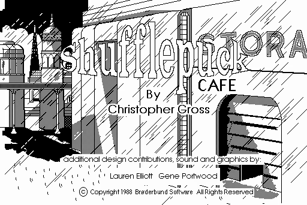

<div align="center">

# 🏓 SHUFFLEPUCK CAFE — a static recomp

```
   ___ _  _ _   _ ___ ___ _    ___ ___ _   _ ___ _  _
  / __| || | | | | __| __| |  | __| _ \ | | / __| |/ /
  \__ \ __ | |_| | _|| _|| |__| _||  _/ |_| | (__| ' <
  |___/_||_|\___/|_| |_| |____|___|_|  \___/ \___|_|\_\
              C   A   F   E   ·   1 9 8 8
```

**Broderbund, 1988 → native code, today.**
No emulator. The original 68k Macintosh binary, taken apart and rebuilt.



*The title screen — the copy-protection is defeated, the 68k is lifted to C, and
the recompiled game boots through the Toolbox HAL and draws this.*

</div>

---

## What is this?

*Shufflepuck Cafe* is a 1988 air-hockey game by **Broderbund** (Christopher Gross,
Lauren Elliott, Gene Portwood). You bellied up to a table in a grimy spaceport
cantina and played one-on-one puck against a gallery of weirdos — the twitchy
robot **Skip Feeney**, the cheating alien **Biff Raunch**, the untouchable
**Princess Bejin**, the monstrous **Adder** — in glorious 512×342 **1-bit black &
white**. The paddle tracked your mouse, the puck cracked off the walls, and your
opponents *talked trash*. A certain kind of kid (👋) sank whole weekends into it.

It's also wonderfully *small* — one `PUCK`-creator application, **6 CODE segments,
~52 KB of 68k**, and its art/sound as resources — which makes it a great candidate
for **static recompilation**: not emulating a Mac, but lifting the original 68000
machine code into C that compiles and runs natively today.

This repo is that effort, built with the [**macrecomp** toolkit](https://github.com/sp00nznet/macrecomp)
(vendored at [`ext/macrecomp`](ext/macrecomp)) — the classic-Mac sibling of the
DOS-era pcrecomp pipeline that resurrected *Bolo* and *SkiFree*.

## Why bother?

Because emulation runs old games; recompilation *frees* them. The output is native
code you can read, debug, fix and extend — widescreen, save states, restored
sound, maybe even the opponents nobody could beat. And because some games deserve
to outlive their 800K floppies.

## How it works

```
  Shufflepuck Cafe (HFS app: CODE 0..5 + 187 PICT + 27 ASND + MENU/DITL/…)
        │  ① extract      ext/macrecomp/tools/extract_resources.py
        ▼
  CODE segments + asset catalog
        │  ② disassemble   capstone M68K
        │  ③ classify      enumerate Toolbox A-traps   ← the go/no-go gate
        ▼
  function table + trap set
        │  ④ lift          68k → C against the macrecomp runtime
        ▼
  C source  ──⑤ HAL──▶  QuickDraw→SDL2, Toolbox→runtime  ──⑥ build──▶  native PUCK
```

## Status

🟢 **Phase 5 — the recomp boots, defeats the copy-protection, lifts every 68k
segment to C, and now runs its render loop drawing real 1-bit content to a
framebuffer.** No emulator; this is the original machine code rebuilt.

Real recon from the 4am-cracked v1.0 disk (`Shufflepuck Cafe`, type `APPL`,
creator `PUCK`, 644 KB resource fork):

- ✅ **Acquired & mounted** the HFS image; extracted every resource with
  macrecomp's `extract_resources.py`. Full map in [`docs/RECON.md`](docs/RECON.md).
- ✅ **Code is tiny:** `CODE` 0–5 = **54,202 bytes** (seg 0 is the 2,136-byte A5
  jump table; the real logic is ~52 KB across 5 segments — smaller than Bolo).
- ✅ **Assets catalogued:** **187 `PICT`** (177 KB, standard 1-bit QuickDraw — the
  table, the bar, every opponent's animation frames), **27 `ASND`** (391 KB —
  Broderbund's *custom* async-sound type, to be reversed), bitmap `FONT`/`FOND`,
  and normal `MENU`/`DITL`/`DLOG`/`WIND`/`ALRT`/`CURS`.
- 🔎 **Scope read:** single B&W window + mouse. The Toolbox surface should be
  bounded — QuickDraw blit, the event loop, a few menus/dialogs, and sound.
  Phase 2 counts the exact traps and confirms.

| Phase | What | State |
|------:|------|-------|
| 0 | Acquire + recon | ✅ [`docs/RECON.md`](docs/RECON.md) |
| 1 | Extract resources (CODE + assets) | ✅ via `ext/macrecomp` |
| 2 | Disassemble + classify trap surface | ✅ [`docs/CLASSIFY.md`](docs/CLASSIFY.md) — **GO, but the code is protected** |
| 2.5 | Unpack the self-decrypting CODE | ✅ [`docs/PROTECTION.md`](docs/PROTECTION.md) — **defeated, byte-exact** |
| 3 | Lift 68k → C | ✅ **98.5 / 99.9 / 100%** coverage; whole program compiles + links |
| 4 | Toolbox HAL → SDL2 (QuickDraw/Event/Sound) | ✅ ~95 traps + Resource Mgr + CopyBits/DrawPicture |
| 5 | Wire the game to the HAL + debug to a playable table | 🟢 **renders real content** — offscreen-bitmap QuickDraw works and composites to the screen; currently parked in the intro/init loop *before* the event loop (input wiring + last draw-fidelity next) |
| 6 | Ship native + extras | ⬜ |

> **Phase 5 breakthrough — the black screen was a calling-convention bug, not a
> QuickDraw one.** The lifter was lowering 68k `jmp` (and fall-throughs) as
> *calls*, which push a fake return address. A `jmp` is a tail transfer, not a
> call — so this corrupted the stack of THINK C's Memory-Manager glue, and every
> `NewPtr` through it returned the fake pointer. The game stored that as the
> `baseAddr` of **all** its offscreen bitmaps, so every draw fell out of bounds →
> black. Fixed in [macrecomp](https://github.com/sp00nznet/macrecomp) with proper
> tail-jumps (`m68k_jump`), a sentinel-aware `rts`, and lowering all three
> THINK C `switch` dispatchers. Offscreen buffers now get real heap addresses and
> the recomp draws real 1-bit art instead of a black void.

> **Phase 2 plot twist — and its resolution.** The game is copy-protected
> (**"HLS Duplication"**): the 68k code is *encrypted at rest* and **CODE 4 is a
> plaintext self-decrypting loader** that unpacks it at launch. We reverse-
> engineered the whole scheme and now defeat it **statically** with
> `ext/macrecomp/tools/unprotect.py`:
> - ✅ **Jump table** — `eor $F55C` + additive chain → the **full function
>   directory** (230 functions: 141 in seg 2, 77 in seg 5) *and* the embedded
>   `_GetResource` decrypt-handler.
> - ✅ **Segment bodies** — per-segment key = a `$32E6`-poly CRC of the handler's
>   own code, seeded by the segment header; decrypt is `next += (cur ^ K)`. All
>   segments recover to **94–97% valid** code, **byte-exact** vs a Ghidra p-code
>   emulation of the real handler (the oracle that cracked the CRC).
> - ✅ **Real trap set:** 182 distinct Toolbox traps — ordinary QuickDraw + events
>   + menus. Bounded and tractable. See [`docs/CLASSIFY.md`](docs/CLASSIFY.md).
>
> Full reverse-engineering writeup in [`docs/PROTECTION.md`](docs/PROTECTION.md).

See [`docs/PLAN.md`](docs/PLAN.md) for the roadmap.

## Repo layout

```
shufflepuck-cafe/
  ext/macrecomp/   the 68k-Mac static-recomp toolkit (git submodule)
  docs/            RECON.md · PLAN.md
  original/        your own copy of the game (gitignored — see below)
  work/            regeneratable extraction/analysis output (gitignored)
  src/             lifted + hand-written runtime glue (later phases)
```

## Building & running

The lifted C **compiles, links, and runs** today — it boots through the Toolbox
HAL and renders 1-bit art, though it isn't *playable* yet (parked in the intro
before the event loop; input wiring is next). Clone with the toolkit submodule,
drop your own disk image in `original/`, and build:

```bash
git clone --recursive https://github.com/sp00nznet/shufflepuck-cafe.git
# already cloned?  git submodule update --init --recursive

# needs: python3 + macresources/machfs/capstone, and a C compiler
# (Windows/MSYS2: export PATH="/c/msys64/mingw64/bin:$PATH" first)
./build.sh "original/Shufflepuck Cafe - Disk 2 (Game).dc42"
```

`build.sh` regenerates the lifted code from *your* image and compiles it —
**nothing game-derived is committed to this repo** (`src/gen/` is gitignored;
see the legal note). Only the hand-written harness (`src/main.c`) and the
toolkit live here.

## Credits & legal

Original game © 1988 **Broderbund Software** (Christopher Gross, Lauren Elliott,
Gene Portwood). *Shufflepuck Cafe* is long out of print and unsupported. This is
a personal preservation / reverse-engineering project.

**No game code or data is included in this repository.** Unlike freely-licensed
shareware, Shufflepuck is commercial abandonware — so the disk image, the
extracted `CODE`/`PICT`/`ASND` resources, and any lifted representation of them
stay out of the repo (`original/` and `work/` are gitignored). You supply your
own copy; a v1.0 image is preserved by the community on the Internet Archive and
Macintosh Garden. All original code here (tooling and hand-written runtime) is
MIT-licensed — see [LICENSE](LICENSE).

Built with [macrecomp](https://github.com/sp00nznet/macrecomp) and far too much
nostalgia for a cantina that never existed.
