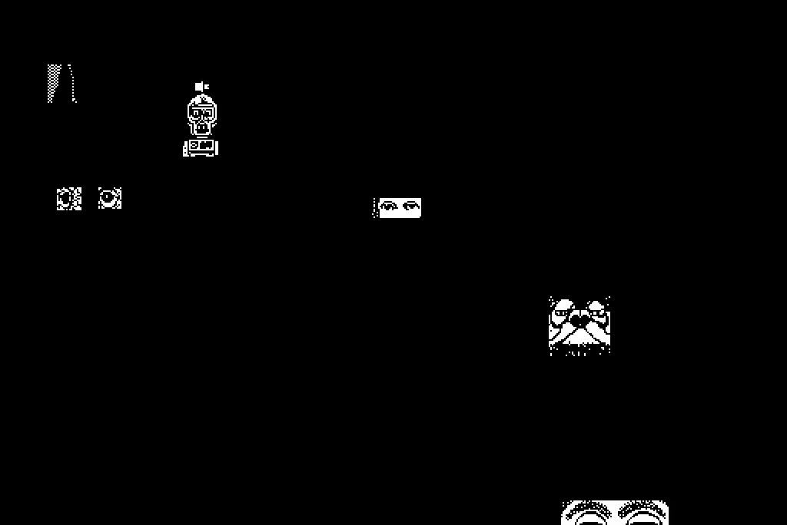

<div align="center">

# 🏓 SHUFFLEPUCK CAFE — a static recomp

```
   ___ _  _ _   _ ___ ___ _    ___ ___ _   _ ___ _  _
  / __| || | | | | __| __| |  | __| _ \ | | / __| |/ /
  \__ \ __ | |_| | _|| _|| |__| _||  _/ |_| | (__| ' <
  |___/_||_|\___/|_| |_| |____|___|_|  \___/ \___|_|\_\
              C   A   F   E   ·   1 9 8 8
```

**Broderbund, 1988 → native code, today.**
No emulator. The original 68k Macintosh binary, taken apart and rebuilt.

</div>

## What it is

A static recompilation of *Shufflepuck Cafe* (Broderbund, 1988; Christopher
Gross, Lauren Elliott, Gene Portwood): the copy-protected 68k Mac application
unpacked, lifted to C, and run natively through a Toolbox HAL over SDL2.

Built on the [**macrecomp**](https://github.com/sp00nznet/macrecomp) toolkit
(vendored at [`ext/macrecomp`](ext/macrecomp)) and following the recomp
collection's shared house style (layout, CLI, conformance harness, headless
mode). It's the classic-Mac sibling of the pcrecomp ports of *Bolo* and *SkiFree*.

**This is an unofficial fan project, not affiliated with Broderbund.** No game
files are in this repository, and neither is the generated C: you supply your
own copy and the pipeline builds everything locally.

## Status: v0.1.0-dev, alpha. It boots, gets past the copy protection, plays the intro and reaches the cantina. It isn't playable yet.

| Stage | State |
|---|---|
| Recon (Phase 0) | done: v1.0 game disk, 6 CODE segments (54,202 B), 187 PICT, 27 ASND ([RECON.md](docs/RECON.md)) |
| Trap surface (Phase 2) | GO: 182 distinct Toolbox traps ([CLASSIFY.md](docs/CLASSIFY.md)) |
| Copy protection (Phase 2.5) | **defeated statically, byte-exact**: HLS Duplication's jump table and per-segment body cipher ([PROTECTION.md](docs/PROTECTION.md)) |
| Lift (Phase 3) | 598 functions, 15,579 instructions, **7 not yet translated** (3 computed `jmp` in CODE 1, 4 in CODE 2) |
| Toolbox HAL (Phase 4) | QuickDraw, Resource, Event, Window, Menu, Dialog and File Managers in macrecomp |
| Run (Phase 5) | **reaches the event loop**: intro credits, then the cantina with the opponents in the dark. Input and the menu to a table are next |
| Headless mode | `--headless --record out.mp4 --watchdog N`: no window, frames piped to ffmpeg. Works over RDP |
| Conformance harness | `tools/conformance.py`: **6/6 boot milestones**, 7 untranslated instructions; fails on regression |
| Sound (ASND) | not started: `trap $A006 unimplemented` (KillIO) is the sound driver's first call |

## Screenshots



*The recompiled game's intro, recorded with `--headless --record`: the
cantina, with the regulars waiting in the dark.*

 

## Getting Started

You need your own copy of *Shufflepuck Cafe* v1.0 as a DiskCopy 4.2 image of
the game disk (`.dc42`). A v1.0 image is preserved by the community on the
Internet Archive and Macintosh Garden. Nothing here downloads it for you.

### Quick start (Windows)

1. Download this repository (Code → Download ZIP) and unzip it, or clone it.
2. Put your game disk image in the `original` folder (or anywhere; Setup asks).
3. Double-click **`Setup.cmd`**. It checks for Python 3.10+, the macrecomp
   toolkit and MSYS2's mingw64 gcc + SDL2, and asks before installing any of
   them. Then it finds your disk image, builds, and makes **`Shufflepuck.cmd`**.
4. Double-click `Shufflepuck.cmd`.

If a step fails, Setup says what to do in one sentence and keeps the details in
`setup.log`. Run it again and finished steps are skipped (`Setup.cmd -Force`
redoes them).

### Step by step

The same steps Setup runs, by hand. Prerequisites: Python 3.10+, git, and
[MSYS2](https://www.msys2.org) (Windows) or gcc + SDL2 + pkg-config (Linux,
macOS). ffmpeg on `PATH` for `--record`.

1. Get the code and the toolkit:
   ```
   git clone --recursive https://github.com/sp00nznet/shufflepuck-cafe.git
   cd shufflepuck-cafe
   ```
   Already cloned without `--recursive`? `git submodule update --init --recursive`.
2. Install the Python packages:
   ```
   py -3 -m pip install --user -r ext/macrecomp/tools/requirements.txt
   ```
3. (Windows) Install the compiler and SDL2, in an MSYS2 shell:
   ```
   pacman -S --needed mingw-w64-x86_64-gcc mingw-w64-x86_64-SDL2 mingw-w64-x86_64-pkgconf
   ```
4. Build, from Git Bash or an MSYS2 shell, with your image in `original/`:
   ```
   export PATH="/c/msys64/mingw64/bin:$PATH"
   export PYTHON="$(cygpath -u "$(py -3 -c 'import sys;print(sys.executable)')")"
   ./build.sh "original/Shufflepuck Cafe - Disk 2 (Game).dc42"
   ```
   Expected output (trimmed):
   ```
   >> extract resources
   volume 'Untitled'  app '/Shufflepuck Cafe'  type=b'APPL' creator=b'PUCK' data=24310 rsrc=644810
   >> unprotect (defeat HLS Duplication)
   jump table: 230 functions  per-segment {1: 9, 2: 141, 3: 2, 4: 1, 5: 77}
   self-check OK (keys match reference)
   >> lift 68k -> C
   CODE 1: 20 functions, 312 insns, 3 unimplemented, 23 traps -> src/gen\code_1.c
   CODE 5: 292 functions, 8191 insns, 0 unimplemented, 408 traps -> src/gen\code_5.c
   CODE 2: 284 functions, 7064 insns, 4 unimplemented, 516 traps -> src/gen\code_2.c
   >> decode PICT art (for CopyBits/DrawPicture)
   decoded 187 PICTs, 0 not decoded -> work/pict_png/
   >> built build/shufflepuck  (run: ./build/shufflepuck work/unpacked)
   ```
5. Run it: `./build/shufflepuck work/unpacked`. On Windows, `SDL2.dll` must be
   on `PATH` (the export above) or next to the exe (Setup copies it there).

**Usual trip-ups.**
- `python` opens the Microsoft Store: that's the Store alias. Use `py -3`.
- `No module named machfs` during the build: with `mingw64/bin` first on `PATH`,
  MSYS2's own Python shadows yours. That's why step 4 sets `PYTHON`.
- `pkg-config: command not found`: the `pkgconf` package from step 3 is missing.
- A tool you just installed isn't found: open a new window to pick up the new `PATH`.

## Usage

```
build/shufflepuck [--headless] [--record out.mp4] [--watchdog secs] [work/unpacked]
```

| Invocation | What it does |
|---|---|
| `build/shufflepuck` | Windowed, 2x scale, reading `work/unpacked`. |
| `build/shufflepuck --headless --record out.mp4 --watchdog 20` | No window, 20 s of video at 30 fps, then a clean exit. Works over RDP. |
| `py -3 tools/conformance.py` | Builds nothing. Runs the headless boot and scores it against `conformance.json` (`--update` accepts a new baseline). Skips with a message if you haven't built yet. |

macrecomp's runtime reads `MR*` environment variables for debugging (`MRTRACE=1`
traces every trap, `MRSHOT=f.pgm` writes the screen on each present, `MRDLG=1`
logs dialog text). They're documented in its source.

## Building from source

`build.sh` is the whole build: extract → unprotect → lift → compile. It
regenerates `work/` and `src/gen/` from your image every time; both are
gitignored, because they're derived from the copyrighted binary. `PYTHON`, `CC`
and `PKG_CONFIG` override the tools. How the parts fit:
[docs/architecture.md](docs/architecture.md).

```
shufflepuck-cafe/
  build.sh            the pipeline
  Setup.cmd           one-click setup (tools/setup.ps1)
  src/main.c          the loader: memory map, jump table, resources, CLI
  tools/conformance.py  the boot/lift harness; conformance.json is its baseline
  ext/macrecomp/      the 68k-Mac recomp toolkit (git submodule)
  docs/               recon, classification, protection, architecture
  original/           your own copy of the game (gitignored)
  work/  src/gen/     generated from it (gitignored)
```

Day-to-day builds can run on [netlab](https://github.com/sp00nznet/netlab)
(`netlab check shufflepuck`). It cross-builds on the mingw builder, and the
QA run skips on machines without game data.

Roadmap: [ROADMAP.md](ROADMAP.md). Changes: [CHANGELOG.md](CHANGELOG.md).
Contributing: [CONTRIBUTING.md](CONTRIBUTING.md).

## License

MIT, see [LICENSE](LICENSE). It covers only the original work in this
repository: the tooling, the loader, the harness and the build scripts.

*Shufflepuck Cafe* itself (the game, its code, and its art and sound) is
© 1988 Broderbund Software, and none of it is included in or distributed by
this repository. Generated source isn't distributed either.
